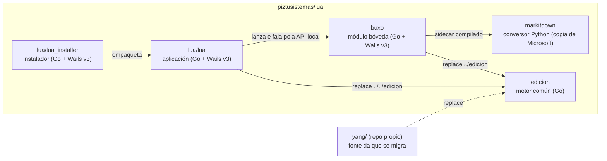

# Arquitectura de Lua

## As pezas

- **`lua/lua`** é o produto. Contén o dominio: cronograma, actas, formularios,
  problemas, asistente e plantillas. Que fai cada ferramenta: [`lua/README.md`](../../lua/README.md).
- **`edicion`** é o motor que comparten Lua, Buxo e Yang. Non importa Wails e
  non coñece a configuración do usuario. Todo lle chega por parámetro ou por
  interface. As súas regras de deseño están en [`edicion/doc.go`](../../edicion/doc.go).
- **`buxo`** é un executable á parte. Lua descárgao como módulo e lánzao. Que fai:
  [`buxo/README.md`](../../buxo/README.md).
- **`lua/lua_installer`** instala Lua e as súas dependencias (LaTeX, etc.) en
  Debian/Ubuntu, Windows e macOS.
- **`markitdown`** é unha copia de MarkItDown, de Microsoft, co plugin propio
  `markitdown-math`. Buxo empaquétao como *sidecar*: un executable Python que
  lanza ao lado do seu. Orixe e como actualizalo: [`markitdown/ORIXE.md`](../../markitdown/ORIXE.md).

Os módulos Go únense con `replace` (`lua/lua/go.mod` → `../../edicion`). Por iso
van no mesmo repositorio: Lua non compila sen `edicion` ao carón.

## Paquetes de `edicion`

| Paquete | Para que |
|---------|----------|
| `actualizacion` | Autoactualización desde as Releases de GitHub. |
| `api` | API local de Lua para os módulos (`PIZTU_API_URL`, `PIZTU_API_TOKEN`). |
| `boveda` | Bóveda de Obsidian (espazo de traballo de Buxo). |
| `calculo` | Avaliador das fórmulas dos nodos «calcular» das tuberías. |
| `cas` | Ponte con Maxima (opcional, con tempo máximo por chamada). |
| `documento` | Xeración de documentos herdada de Yang. |
| `ficha` | Importar formularios de Lua como fichas. |
| `ia` | Cliente de IA conversacional con chamadas a ferramentas. |
| `latex` | Escape, preámbulo e compilación LaTeX; paquetes requiridos. |
| `lectura` | Lectura de PDF por capas (texto, páxinas). |
| `modulo` | Instalar e localizar módulos descargables (Buxo). |
| `plantilla` | Biblioteca de plantillas e preámbulo obrigatorio. |
| `plataforma` | Diferenzas entre macOS, Windows e Linux (PATH, bundle, Homebrew). |
| `ui` | Pontes co toolkit gráfico que non poden vivir nas apps. |
| `vivas` | A IA propón cambios a unha ficha. |
| `web` | Frontend compartido (JS/CSS) que se copia ás apps. |
| `xerar` | Motor de problemas (variables, sementes, Maxima). |

O frontend compartido vive en `edicion/web/estatico/`. Cópiase a cada app con
`cd edicion && go run ./cmd/sincronizarweb <destinos>`. As copias **non se
editan á man**: un test de cada app falla se se desvían.

## Ferramentas externas

| Ferramenta | Uso | Se falta |
|------------|-----|----------|
| TeX Live / MacTeX (`pdflatex`, `xelatex`) | PDF de todos os informes | Lua non xera PDF e di que instalar |
| Maxima | Problemas e cálculo simbólico | Os problemas non se resolven |
| LibreOffice (`soffice`) | Vista previa e lectura de Word/ODT | Sen vista previa ofimática |
| `pdftotext`, `pdffonts` (Poppler) | Tests e lectura de PDF | Os tests que os usan sáltanse |
| ImageMagick, Inkscape, dcraw | Converter imaxes raras a PNG | Lua di que instalar |
| Provedor de IA (Gemini, Claude, compatible OpenAI) | Asistente, Buxo, problemas | As funcións de IA non aparecen |

Todo se lanza con `exec` e argumentos separados, nunca a través dun shell, e
LaTeX vai sen `--shell-escape` (constitución, regra 5.3).

## Lua e Buxo

1. Lua descarga `buxo_<versión>_<so>_<arq>.zip` da última Release, comproba o
   SHA-256 e instálao no seu cartafol de módulos (`edicion/modulo`).
2. Lua lánzao con `buxo --boveda <cartafol> --materia <texto> --id <id>` e coas
   variables `PIZTU_API_URL` e `PIZTU_API_TOKEN`.
3. Buxo pide a Lua os turnos de IA e as ferramentas `boveda_*` pola API local.
   Buxo nunca ve a clave da IA.

## Versións e Releases

- CalVer `AA.MM.N`. Lua e Buxo saen coa **mesma versión** na mesma Release.
- En Lua, a versión está en seis sitios que deben coincidir: `VERSION`,
  `wails.json`, `modulo.json`, `build/config.yml` e `build/darwin/Info*.plist`.
- O actualizador mira só a **última** Release de `piztusistemas/lua` e, dentro
  dela, o zip da súa plataforma.

Como facer unha Release: [desenvolvemento](desenvolvemento.md#publicar-unha-release).
