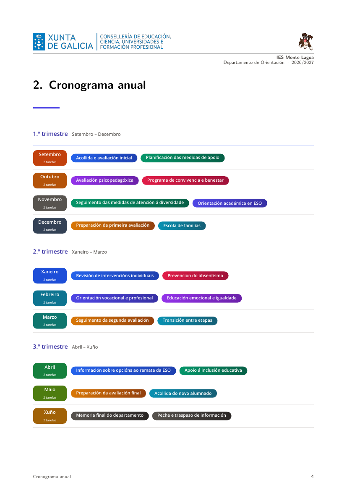
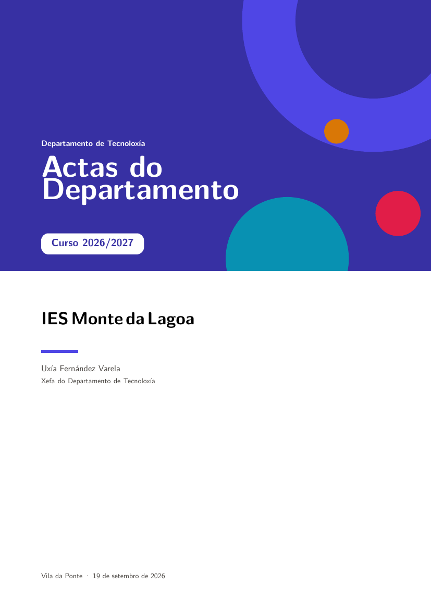
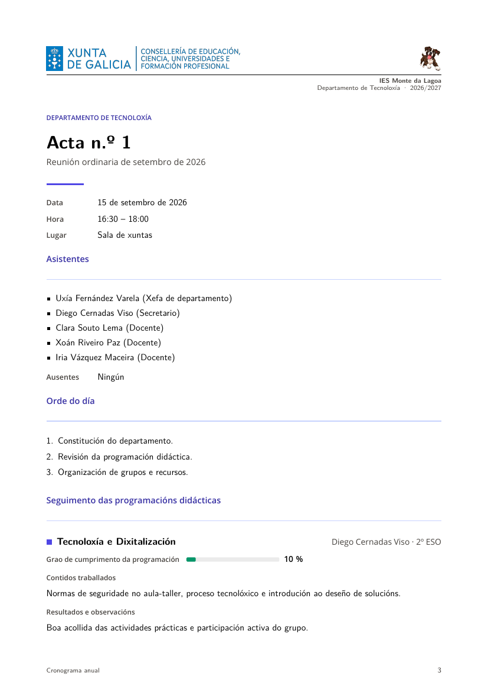

Cada curso, os departamentos didácticos repiten a mesma tarefa: actualizar o
**cronograma anual**, redactar a **acta** de cada reunión e cubrir o
**seguimento das programacións** materia por materia. Facer iso en Word ou en
Writer significa loitar co formato cada vez que se pega un texto, perder a conta
dos meses e reescribir cabeceiras, pés e portadas en cada documento.

**Lúa** é o módulo de Piztu que resolve exactamente isto: recolle os datos do
centro, do departamento e do curso nun formulario e **xera o documento
completo** —portada, índice, introdución, cronograma, actas e sinatura—
compilado en **LaTeX** co estilo do centro. Ti escribes o contido; Lúa encárgase
da estrutura e da estética.

- Repositorio: [github.com/piztusistemas/lua](https://github.com/piztusistemas/lua)
- Última versión: [26.9.6](https://github.com/piztusistemas/lua/releases/tag/26.9.6)
  (instaladores para Linux, Windows e macOS)

---

## Que é Lúa e que problema resolve

Lúa é un **módulo de Piztu** (ten o seu `modulo.json`, cun `id`, unha icona e un
executable) que tamén se pode instalar e usar de forma autónoma, sen Piztu. A
súa razón de ser é unha soa: **xerar a documentación dos departamentos didácticos
dos centros educativos**.

Non é unha plantilla de Word máis. É un xerador de documentos: o contido
(gardado nun ficheiro JSON) sepárase por completo do deseño (a *plantilla* do
centro), e o resultado compílase con LaTeX. Iso dá tres cousas que un procesador
de textos non dá de serie:

- **Estrutura automática.** Portada, índice, introdución, cronograma, meses,
  actas e sinatura xéranse sempre na mesma orde e co mesmo estilo.
- **Deseño centralizado.** O logotipo, as cores, a cabeceira e o pé viven nunha
  plantilla; cando cambia a imaxe corporativa, cámbiase nun sitio e todos os
  documentos saen actualizados.
- **Exportación múltiple.** Do mesmo contido sácanse PDF, TeX, Markdown, Word
  (`.docx`) e OpenDocument (`.odt`). Word e ODT escríbense directamente, **sen
  precisar ferramentas externas**.

E serve para **calquera departamento didáctico**, non só para Orientación: o
departamento escríbese nun campo e todo o documento (títulos, cabeceiras,
rótulos) adáptase.

## Que documentos xera

### Cronograma anual

Os datos do curso, do centro e do departamento, e as tarefas de cada mes, coa
descrición en **Markdown** (negrita, listas, ligazóns, imaxes, aliñación…). O
documento leva portada, índice, introdución, o **cronograma anual** e o
**desenvolvemento por meses**.

O cronograma anual vaise **só a imaxe**, organizado por trimestres, cun detalle
de deseño que importa: **un trimestre nunca se corta polo medio**; se non cabe na
páxina, pasa enteiro á seguinte.

### Actas do departamento

Unha xanela de **datos do departamento e materias impartidas**: membros,
materias con docente e grupos, secretario/a, hora e lugar habituais. Despois, por
cada mes do curso:

- a **acta mensual** (asistentes, orde do día, desenvolvemento da sesión,
  acordos, rogos e preguntas, sinaturas);
- un **informe de seguimento por cada materia** configurada: contidos
  traballados, grao de cumprimento da programación, resultados e observacións,
  dificultades detectadas e medidas de mellora.

A acta **recolle automaticamente** os datos deses informes. E pódese xerar e
imprimir **unha acta soa ou todas as do curso** co selector de ámbito da vista
previa: o curso enteiro engade portada e índice; unha acta solta sae soa.

### Un mesmo motor para todo

Cronograma e actas comparten a biblioteca de plantillas, o compilador LaTeX, as
exportacións e o asistente de IA. A lóxica común está nun **controlador único**:
cada ferramenta só achega o seu modelo de datos, o seu editor e a súa petición ao
backend. Iso é, como se ve máis abaixo, o que fai relativamente doado engadir
novos tipos de documento.

## Características fundamentais

### Unha barra de ferramentas, un documento por ferramenta

Lúa ten unha **columna de ferramentas á esquerda**, só con iconas (o nome aparece
no *tooltip*). Cada ferramenta conserva o seu propio curso, o seu ficheiro, o seu
**desfacer/refacer** e o seu resultado: pódese pasar dun cronograma a unhas actas
sen perder nada.

- **Borrador automático** e historial de desfacer limitado por número de pasos e
  por tamaño (os cursos levan imaxes en base64).
- **Vista previa** do PDF compilado á dereita, que se refresca ao xerar.
- **Xanela desprazable:** o botón *Desacoplar* leva o resultado a unha xanela á
  parte, moi útil con dous monitores; mentres está desprazado, un botón permite
  ampliar o editor ao 100 % do ancho.
- **Editor de tarefas nunha xanela propia**, maximizada e movible a outro
  monitor, con *Aplicar* (garda sen pechar), *Gardar* (garda e pecha) e aviso de
  cambios sen gardar.

### Plantillas: a estética é do centro

Unha **plantilla** é o estilo dun centro: cabeceira (logotipo, nome,
departamento), pé (quen orienta, teléfonos, correo), marxes, portada e sinatura.
A biblioteca de plantillas é compartida por todas as ferramentas.

- A plantilla é **LaTeX cun marcador `{{CORPO}}`** (onde vai o informe) e
  variables `{{TELEFONO}}`, `{{CORREO}}`… que se enchen unha vez.
- Lúa enche soa `{{CENTRO}}`, `{{CURSO}}`, `{{ORIENTADOR}}`, `{{DEPARTAMENTO}}`,
  `{{LOCALIDADE}}`, `{{CARGO}}`, `{{DATA}}`, `{{ANO}}`, `{{TITULO}}` e
  `{{FICHEIRO}}`. Unha variable da plantilla con valor **gaña** sobre a
  automática: así un centro fixa o seu nome unha vez e non o escribe en cada
  curso.
- Pode ser un **fragmento** (só cabeceira e pé; o preámbulo ponoo Lúa) ou unha
  plantilla **completa**, co seu `\documentclass`, marxes e fontes.
- O logotipo sóbese como imaxe da plantilla e úsase por nome
  (`\includegraphics{logotipo.png}`).
- As plantillas **expórtanse e impórtanse** nun ficheiro `.json` (texto + imaxes
  en base64) para que todo o departamento use o mesmo estilo, e tamén se poden
  **crear coa IA a partir dun documento de mostra**.

E hai unha separación de responsabilidades moi clara: **Lúa xera o contido; o
deseño e os textos son da plantilla**. O formato dos títulos e as etiquetas van no
bloque *Estilo*; **todos** os textos fixos («Índice», «Sen tarefas», os rótulos
das actas…) van no bloque *Textos do documento*. Non hai texto no documento que
non se poida cambiar.

### O editor de plantillas

*Editar* unha plantilla (ou *Nova en branco*) abre o editor nunha **xanela propia,
maximizada**, que se pode desmaximizar e levar a outro monitor. Está organizado en
**bloques e tres columnas** (*Datos e recursos*, *PDF e LaTeX*, *Word e
OpenDocument*), pero de primeiras só se ven a identidade e a maqueta: unha fila de
botóns (o **lanzador**) despraga cada bloque ao premelo. Lúa lembra os bloques
abertos e agocha as columnas baleiras. Hai bloques para identidade, textos,
variables, imaxes, maqueta, portada, sinatura, introdución, estilo, Markdown,
letra e marxes, cores, cabeceira e pé, e a portada de Word/OpenDocument.

A vista previa pode facerse sobre un **cronograma ou unhas actas de mostra**, en
PDF, Word ou OpenDocument. **Aplicar** (Ctrl+S) garda a plantilla **sen pechar**,
refresca a vista previa e avisa á xanela principal, que rexenera o informe se é a
plantilla en uso: así se axusta o deseño de forma continua, sen pechar, probar e
volver abrir. **Gardar** (Ctrl+Intro) garda e pecha.

### Word e OpenDocument sen ferramentas externas

Aínda que o núcleo sexa LaTeX, Lúa non deixa fóra a ofimática. Cada plantilla
leva un bloque `ofimatica` propio: fonte, cinco cores, tamaño do texto,
interliñado e catro marxes, ademais de portada, cabeceira e pé. Eses elementos
escríbense por liñas e poden levar **varios logotipos en liña** e variables
(`{{CENTRO}}`, `{{CURSO}}`…). Os `.docx` e `.odt` xéranse directamente, sen
LibreOffice nin Pandoc.

### Idiomas, instalación e actualización

- **Catro idiomas** (galego, castelán, inglés e portugués). Se Lúa se abre desde
  Piztu, herda o idioma que o profesorado escolleu en ⚙ Aula; a elección feita en
  Opcións sempre gaña.
- **Instalador propio** para Debian/Ubuntu, Windows e macOS, que ademais instala
  LaTeX e as súas dependencias. En Linux o módulo vai a `/opt/piztu/modulos/lua`;
  en Windows, a `Program Files`; en macOS, a `/Applications/Lua.app`.
- **Actualización integrada**: Lúa consulta as releases de
  `piztusistemas/lua` en GitHub, descarga a versión nova, **comproba o
  `sha256`** e substitúe o executable en execución.
- **Requisitos**: LaTeX (`pdflatex`, `xelatex` ou `lualatex`, a escoller en
  Opcións) e `poppler-utils` para a vista previa. Word e OpenDocument non
  precisan nada externo.

## Os dous documentos de mostra

Para que se vexa o resultado real, o repositorio publica **dous documentos xa
compilados**: un cronograma e unhas actas completas dun curso 2026/2027.

### Cronograma anual (8 páxinas)


Exemplo dun **Departamento de Orientación** (IES Monte Lagoa, Curtis): portada
coa imaxe corporativa, índice con introdución, cronograma anual por trimestres e
desenvolvemento por meses. Cada mes leva as súas tarefas coa descrición en
Markdown.



### Actas do departamento (22 páxinas)



Exemplo dun **Departamento de Tecnoloxía** (IES Monte da Lagoa): dez actas
mensuais (setembro a xuño) con orde do día, seguimento das programacións por
materia —grao de cumprimento, contidos, resultados, dificultades e medidas—,
acordos, rogos e sinatura.



**Descargas directas dos dous documentos:**

| Documento | Formato | Ligazón |
|---|---|---|
| Cronograma 2026/2027 | PDF (8 páx.) | [cronograma-2026-2027.pdf](https://github.com/piztusistemas/lua/raw/main/cronograma-2026-2027.pdf) |
| Actas 2026/2027 | PDF (22 páx.) | [actas-2026-2027.pdf](https://github.com/piztusistemas/lua/raw/main/actas-2026-2027.pdf) |

## Os dous estilos de mostra

Xunto cos documentos, o repositorio publica as **plantillas** coas que se
xeraron: `cronograma IES.json` e `actas IES.json`. Son ficheiros de intercambio
de Lúa (`"formato": "lua-plantilla"`) que se poden **importar na biblioteca de
plantillas** e reutilizar tal cal, ou duplicar e adaptar ao propio centro.

| Plantilla | Que define | Ligazón |
|---|---|---|
| `cronograma IES` | Estilo do cronograma; sube ~30 % o tamaño dos logotipos da cabeceira en PDF, Word e OpenDocument | [cronograma IES.json](https://github.com/piztusistemas/lua/raw/main/cronograma%20IES.json) |
| `actas IES` | Mesmo estilo, coa portada adaptada a «Actas do Departamento» | [actas IES.json](https://github.com/piztusistemas/lua/raw/main/actas%20IES.json) |

Anatomía dunha plantilla (resumida):

```jsonc
{
  "formato": "lua-plantilla",
  "version": 1,
  "plantilla": {
    "nome": "cronograma IES",
    "descricion": "Aumenta aprox. un 30 % o tamaño dos dous logotipos da cabeceira…",
    "latex": "…{{CORPO}}…",              // maqueta do PDF: cabeceira, pé, marxes
    "portada": "\\begin{tikzpicture}…",  // portada en LaTeX (tikz)
    "sinatura": "…",                     // última folla
    "estilo": "",                        // formato de títulos e etiquetas
    "ofimatica": {                       // deseño de Word e OpenDocument
      "fonte": "Arial",
      "corPrincipal": "223A5E",
      "corSecundaria": "00A6D6",
      "tamanoCorpo": 11,
      "portada": "@espazo 20\n# CRONOGRAMA ANUAL\n## {{DEPARTAMENTO}}…",
      "cabeceira": "@esquerda\n@imaxe conselleria_logo.png 10.4\n@dereita\n@imaxe logo.png 10.4\n…",
      "pe": "@centro\nCronograma anual · {{CENTRO}}",
      "marxeInferior": 2.2
    },
    "motor": "lualatex",                 // pdflatex, xelatex ou lualatex
    "variables": []
  },
  "imaxes": [                            // logotipos en base64, autocontidos
    { "nome": "conselleria_logo.png", "dataB64": "iVBORw0KG…" },
    { "nome": "logo.png", "dataB64": "iVBORw0KG…" }
  ]
}
```

Dous detalles que ilustran a filosofía do proxecto:

- **O ficheiro é autocontido.** As imaxes van dentro en base64, así que unha
  plantilla compártese cun só `.json` e chega con todo.
- **Ao importala, Lúa crea unha copia propia.** As plantillas de fábrica non se
  pisan: importar unha mostra xera unha nova entrada na biblioteca, lista para
  editar.

## Integración coa IA

Lúa naceu cun **asistente integrado** que non é un chatbot á parte: é unha capa
que **controla o propio programa**. Funciona cun esquema de ferramentas no estilo
**MCP**: a IA recibe un catálogo (`tools/list`) e pide executar accións
(`tools/call`).

**Provedores.** Funciona con **Google Gemini** (API nativa), **Anthropic/Claude**
(API nativa) e **calquera provedor compatible con OpenAI** —OpenAI, Qwen/DashScope,
Perplexity, Groq, Mistral, DeepSeek, Ollama en local…—; a clave e o modelo
configúranse en Opcións.

**Que pode facer.** O catálogo de ferramentas cobre practicamente todo o
programa:

- **Curso e tarefas:** `curso_ler`, `curso_configurar`, `curso_novo`,
  `curso_gardar`, `curso_logotipo`, `tarefa_engadir`, `tarefa_editar`,
  `tarefa_mover`, `tarefa_eliminar`, `tarefa_imaxe`…
- **Actas:** `actas_ler`, `actas_configurar`, `actas_membros`,
  `actas_materias`, `acta_gardar`, `acta_seguimento`, `acta_eliminar`,
  `actas_ambito`.
- **Informe:** `informe_xerar` e `informe_exportar` (PDF, TeX, Markdown, Word,
  OpenDocument).
- **Plantillas:** `plantilla_ler`, `plantilla_gardar`, `plantilla_duplicar`,
  `plantilla_escoller`, `plantilla_previsualizar`, `plantilla_comprobar`,
  `plantilla_imaxe_eliminar`…
- **Contorno:** `opcions_ler`/`opcions_cambiar`, `web_buscar`, `web_consultar`,
  `usuario_avisar`, `usuario_preguntar` e os adxuntos.

**Tres ámbitos, cada un restrinxido.** O asistente xeral ve o curso completo; o
asistente **dentro da tarefa** só ve o borrador desa tarefa; o asistente do
**editor de plantillas** só ve o borrador da plantilla. Cada un ten as súas
ferramentas e non pode tocar o que non lle toca.

**Adxuntos e visión.** Á conversa pódense xuntar imaxes, PDF, Word, OpenDocument,
presentacións, follas de cálculo, RTF e texto. A IA **ve** as imaxes (con modelo
de visión), **le** o texto dos documentos longos, pode **ver páxinas** de PDF ou
Word e **extraer as imaxes** dun documento (por exemplo, o logotipo dun papel
timbrado). Os adxuntos viven nun almacén temporal que se borra ao arrincar e con
«Nova conversa»; só o que se decide gardar pasa a un sitio definitivo (unha
plantilla ou o JSON do curso).

**Seguridade.** A clave da API e o provedor **non son accesibles á IA**. As
accións que non se poden desfacer (gardar/eliminar plantillas, curso novo) piden
confirmación, hai un modo «confirmar cada cambio» e as edicións entran no
historial de Desfacer. Ademais, o que devolven as ferramentas (páxinas web,
ficheiros, textos) trátase sempre como **dato**, nunca como instrución: se un
texto lido intenta dar ordes, ignórase.

### Dúas direccións de integración

1. **IA dentro de Lúa** (xa dispoñible): o asistente crea e mellora contido,
   redacta a introdución, corrixe, busca lexislación en fontes oficiais e
   constrúe ou modifica plantillas a partir dun documento de mostra.
2. **Lúa dentro dun fluxo con IA**: como o contido vive nun **JSON limpo e
   documentado**, calquera axente ou módulo pode xerar ou completar ese JSON e
   Lúa encárgase de compilalo. É unha fronteira de integración moi natural para
   automatizacións (por exemplo, un asistente que prepara o borrador do
   cronograma a partir da programación xeral anual do centro).

## Novos tipos de documentos: memorias e máis alá

A arquitectura de Lúa está pensada para medrar. Engadir un tipo de documento
novo —unha **memoria anual do departamento**, por exemplo— non require tocar o
motor: consiste en definir os datos e a súa sección LaTeX, e deixar que o
controlador común faga o resto.

### A peza clave: o contrato «ferramenta»

Cada tipo de documento é unha **ferramenta** que se lle entrega ao controlador
común. Este contrato é pequeno e explícito:

```js
export const FERRAMENTA_MEMORIA = {
  id: 'memoria',
  novoPlan,                 // modelo baleiro
  lerFicheiro,              // abrir un .json da memoria
  escribirFicheiro,         // gardar
  nomeFicheiroSuxerido,     // nome proposto ao exportar
  crearEditor: createMemoriaEditor,
  validarDatas: (plan) => validarDatas(plan.config.startDate, plan.config.endDate),
  haiContido(plan) { /* hai algo que gardar? */ },
  descricionCurso: (c, t) => `${c.academicYear} · ${c.schoolName}`,
  // O que se lle manda ao backend (XerarInformeCronogramaRequest en Go).
  peticion: (plan, { tipografia, nomeBase }) => ({
    ferramenta: 'memoria', plan, tipografia, nomeBase,
  }),
}
```

En canto existe esa ferramenta, **o controlador xa lle dá de balde**: xestión do
curso en edición, apertura e gardado de ficheiros, desfacer/refacer, borrador
automático, barra de estado, vista previa, exportacións e integración co
asistente. Só hai que escribir o modelo e o editor.

### Os pasos, en concreto

1. **Modelo de datos** (por exemplo, `PlanMemoria`): datos do centro e do
   departamento, balance do curso por ámbitos, obxectivos acadados, resultados,
   propostas de mellora…
2. **Frontend:** `ferramenta-memoria.js` co contrato de arriba e un
   `memoria-editor.js` que pinte os campos.
3. **Backend:** `informe_memoria.go`, coa petición, a composición LaTeX do
   documento e as exportacións, **reutilizando o motor compartido** de compilación
   e o de Word/OpenDocument.
4. **Plantilla:** reutilizar unha existente (o deseño xa é xenérico) ou crear
   unha propia; se hai un documento modelo do centro, a IA pode **derivar a
   plantilla** a partir del.

### Que se pode xerar con este esquema

- **Memoria anual do departamento** (a máis pedida: peche de curso).
- **Programación didáctica** por materia e curso.
- **Informe de materia** ou de seguimento individualizado.
- **Plan de convivencia**, **plan de mellora**, **plan de acollida**…
- **Memoria de actividades complementarias** e extraescolares.
- **Acta de avaliación** ou calquera documento con estrutura fixa e datos
  variables.

O interesante é que todos comparten a mesma idea: **Lúa pon o contido e a
estrutura; a plantilla pon a estética**. Engadir un tipo novo é, sobre todo, un
exercicio de definir ben os datos e a súa sección no documento.

## Como probalo

1. **Descarga o instalador** da última versión para o teu sistema:
   [Release 26.9.6](https://github.com/piztusistemas/lua/releases/tag/26.9.6)
   — `lua-installer` (Linux), `lua-installer.exe` (Windows),
   `lua-installer-macos.app.zip` (macOS).
2. **Instala LaTeX** e `poppler-utils` se non os tes; o instalador e o propio Lúa
   tamén poden facelo.
3. **Importa as plantillas de mostra** (`cronograma IES.json` e
   `actas IES.json`) desde a biblioteca de plantillas do editor.
4. **Crea o teu curso**, enche os datos do centro e do departamento, engade
   tarefas ou actas e preme **Xerar**.

Se tes Piztu instalado, Lúa aparece como un módulo máis en ⚙ Aula → Módulos.

---

*Piztu Sistemas — Martín Pardiñas · [piztu.org](https://piztu.org) · Licenza
AGPLv3. Software libre: pódese usar, estudar, modificar e redistribuír; calquera
traballo derivado, incluído o ofrecido como servizo en rede, ten que publicarse
tamén baixo AGPLv3 co código fonte dispoñible.*
